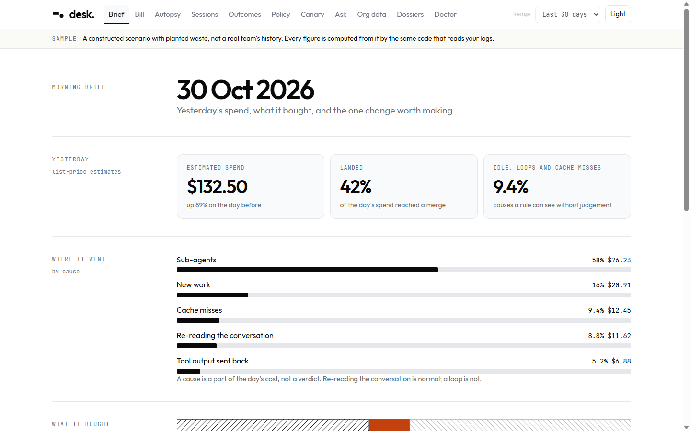
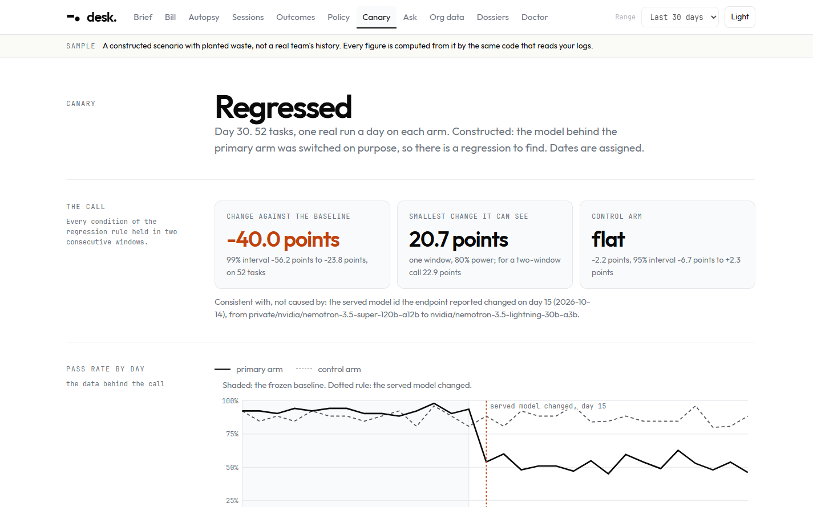
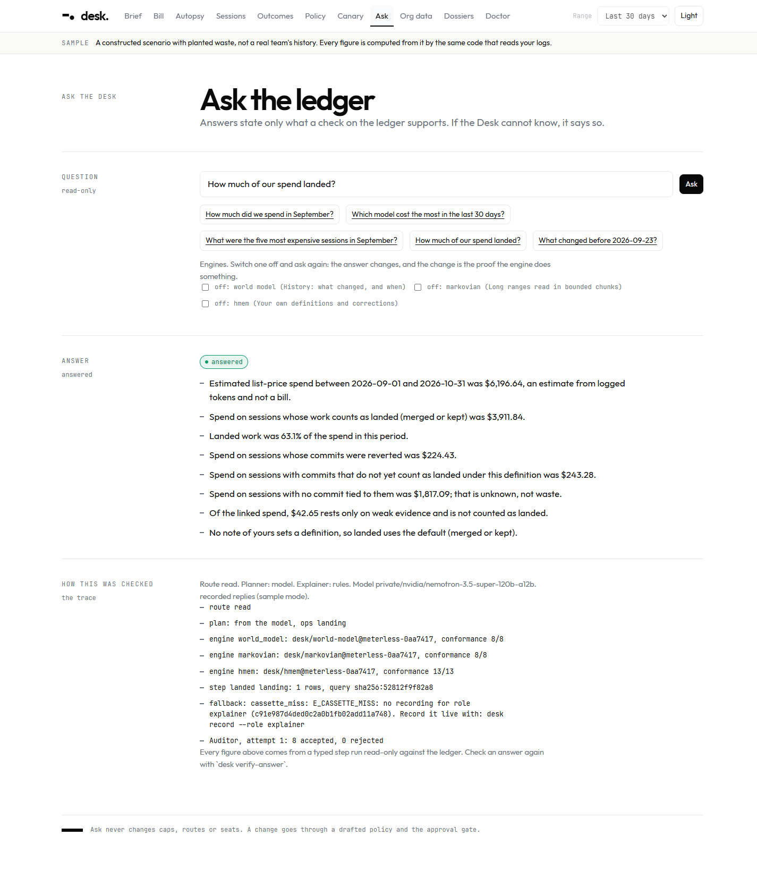
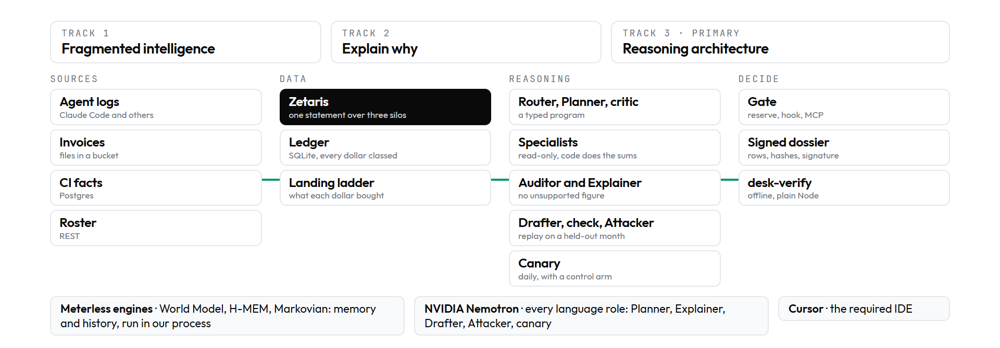

# desk.

**Every dollar your agents spend, tied to work that landed.**

desk. is a local desk for the person who pays for AI coding agents. It explains why a limit was hit, checks every day whether the agent got worse, tests a spend policy on a month it never saw, and signs what it concludes so that a stranger can verify it offline. No account, no upload: it reads your agent logs on your machine.

Built for the Open Agent Hackathon 2026, Track 3 (Reasoning Architecture), with Zetaris, Meterless and NVIDIA Nemotron.

> We are building an agent that helps **an engineering lead who pays for coding agents** decide **next month's caps and routes** by **tying every dollar to the work that landed and testing a policy on a month it never saw**, using **the agents' own session logs, git history, and three Zetaris-joined sources (invoices, CI, a seat roster)**, producing **a limit autopsy, a daily regression verdict, and a signed, replay-tested spend policy a stranger can verify offline**.

| | | |
|---|---|---|
|  |  |  |
| The brief | The canary: a regression called, control arm flat | Ask: every figure comes from a typed step |

Skim path: [The idea](#the-idea), [One product, three tracks](#one-product-three-tracks), [Try it](#try-it), [The evidence](#the-evidence), [Where it goes](#where-it-goes).

## The idea

Most tools that watch AI spend show a number. desk. treats every number as a claim: it must carry the rows it came from, say what it could not know, and survive a test on data it never saw. The same discipline runs through the whole product. A figure is computed by code, never by the model. A policy is replayed on a month it was not drafted from, and the headline is the landed work it would have blocked. A regression is called only against a control arm. A conclusion is signed so that a stranger can verify it offline. Where it fell short of its own label (a "90%" range that held 73% of the time), it says so on screen.

Usage trackers such as ccusage and CodexBar read agent logs and show cost; as far as we read them on 2026-10-20 (`docs/design/desk/05-track-coverage-and-sources.md`), none ties each dollar to landed work, replays a policy on a month it did not see, calls a regression against a control arm, or signs the result. desk. takes their log-reading and pace ideas and adds those.

## One product, three tracks



One primary track is judged, and we submit under **Track 3**. The same product also does the work of the other two. The diagram shows the parts; the table says which parts each track relies on.

| Track | Where it lives in desk. | Try it |
|---|---|---|
| 1. Solving fragmented intelligence | Agent logs, plus invoices (files), CI (Postgres) and a seat roster (REST) joined by one Zetaris statement into one ledger. The three silos are synthetic, derived from the constructed sample; the single statement that joins them and the conflicts it finds are real code. It shows where the sources disagree: invoices land 1.2% under the list-price estimate, and 60 of 644 landed sessions merged although the checks were red. | `desk silos`, `desk landing` |
| 2. The agent that can explain why | Ask turns a question into a typed program that read-only specialists run, and an Auditor rejects any figure no claim supports. Every conclusion is a signed dossier that a stranger verifies offline; one changed byte names the row. | `desk ask`, `npm run desk-verify` |
| 3. Reasoning architecture (primary) | Plan, critique, revise, replay: a Planner and its critic, specialists, an Auditor and Explainer, a Drafter, a restrict-only check and an Attacker, a canary with a control arm, Meterless engines as memory, Nemotron in every language role, and a pre-registered head-to-head against a tool agent. | `desk propose`, `desk bench report` |

## Try it

Needs Node 22.19 or later (run on 22.23 and 24.20; 22.19 itself is NOT VERIFIED). Nothing else for the sample.

```
git clone https://github.com/Pratiikpy/agent-spend-desk.git && cd agent-spend-desk
npm install
npm run desk -- --sample      # the limit autopsy card, on a constructed sample, offline (about 20 seconds)
npm run desk -- demo          # the whole demo in eight beats, offline (under a minute)
npm run desk -- ui --sample   # twelve screens on a local, read-only server
npm run desk -- prove         # every check, each PASS, FAIL or NOT RUN
npm test                      # the unit and integration tests
```

**On your own logs:** `npm run desk` reads `~/.claude/projects` read-only and prints your own limit autopsy in under three minutes: where your last heavy window went, which fix is worth making, and what the Desk could not know. Add `--repo <path>` to tie sessions to commits. Nothing is written outside `data/desk/`.

Verified from a fresh clone of the final commit, each with the card (same figures hash), `desk prove` (26 PASS, 0 FAIL, 0 NOT RUN) and 468 tests: Windows 11 on Node 24.20, and Ubuntu 22.04 (WSL) on Node 22.23. Node 22.19 and macOS are NOT VERIFIED at this commit. On PowerShell, `$env:SAMPLE_MODE="true"` does the same as `--sample`.

## The problem

An engineering lead pays for a team's coding agents, on seats and on tokens. The bill is a number and the limit is a message; nothing says what the money bought. The decision is next month's caps and routes, and today it is made without evidence. desk. ties each dollar to the work that landed (a commit, a merge, a revert), shows which cause ate the limit, and tests a policy before it is applied.

The pain is public. These are quotes from the sources we read on 2026-10-20 (each URL was fetched then and not re-opened since; the full table is `docs/design/desk/04-evidence-table.md`):

- "Did not use Claude Code for three days. Never hit usage limits in the last three months. Now hitting usage limits after 2 hours of continous usage." ([claude-code #16157](https://github.com/anthropics/claude-code/issues/16157))
- "my ChatGPT Plus Codex budget drains in 2–3 prompts on `gpt-5.5`, where the same model/plan/app previously gave 20+ prompts." ([codex #28879](https://github.com/openai/codex/issues/28879))
- "The dashboard has a multi-day reporting lag, so I had no idea anything was wrong until the limit email landed." (a user who [burned $6,000 of usage](https://www.reddit.com/r/ClaudeAI/comments/1t11mmy/i_accidentally_burned_6000_of_claude_usage/))
- "My session silently routed to a different model path." ([r/cursor](https://www.reddit.com/r/cursor/comments/1t2gjtl/cursor_silently_switched_models_while_i_was_deep/))
- "Every assigned seat bills at list whether or not the user opens Copilot." ([Redress Compliance](https://redresscompliance.com/microsoft-copilot-adoption-2026))

The first three are why the autopsy exists, the fourth is why the canary runs every day, the fifth is why seats are tied to landed work.

## What it does

| You ask | desk. answers with | Command |
|---|---|---|
| Where did my limit go? | The heaviest window split by cause, with ranked fixes and a block of what it could not know | `desk card` |
| What did the money buy? | Spend by landing state: kept, merged, committed, reverted, unlinked (unlinked is unknowable, not waste) | `desk landing` |
| What do my invoices, CI and roster say? | One Zetaris statement over three sources: billed against estimated, spend per landed pull request | `desk silos` |
| Did the agent get worse? | A daily canary: verdict, interval, control arm, and what it cannot say | `desk canary` |
| What should the caps be? | A drafted policy that is checked, attacked, then replayed on a month it never saw | `desk propose --dossier` |
| Can I trust that? | A signed dossier a stranger verifies offline; one changed byte names the row | `desk approve`, `npm run desk-verify` |
| Why did it change? | An answer from typed, read-only steps that an Auditor checks; engines can be switched off | `desk ask` |
| Is the reasoning architecture better than calling the model? | A pre-registered 60-question head-to-head, with its first losing run and its misses | `desk bench report` |
| Can it stop a runaway? | A local gate that Claude Code calls before each tool use; it fails closed | `desk gate serve` |

Route replay, seat return, calibration, the regret ledger and learning from mistakes are in [docs/commands.md](docs/commands.md).

## The evidence

- **A regression, called.** The canary calls the planted model switch on day 15: **-40.0 points, 99% interval -56.2 to -23.8, control arm flat**. A first run on 16 tasks refused to call it, and both runs are in the repository.
- **A head-to-head, pre-registered.** Same Nemotron model, 60 questions it never saw: the Desk **49 exact against a tool agent's 41 and one call's 12** (54 after a fix made after reading the misses, shown beside the first figure, never in place of it). Eight in sixty is at the edge of what that sample can show, and several written predictions failed.
- **Held-out replay.** A policy drafted from September meets October: it would have blocked **5 of 333** landed sessions. That, not the savings, is the headline.
- **A verifier a stranger can run.** `desk-verify` recomputes a signed dossier's figures on plain Node with the network off; one changed byte names the row. A signature proves the record was not altered after signing and that its figures follow from its rows; it does not prove that the agent logs were truthful.
- **Its own confidence, measured and published.** The wind tunnel's "90%" range held the real month in **73%** of 48 constructed samples (77% with no change planted), and learning from mistakes moved 2 of 60 questions with an interval that touches zero, so no improvement is claimed.
- **`desk prove`:** 26 PASS, 0 FAIL, 0 NOT RUN on a fresh clone. NOT RUN names a check the spec asks for that is not built or not recorded; it is never counted as a pass.

Every figure, its file, and the failures: [docs/evidence.md](docs/evidence.md) and `docs/verification/`.

## How it is built

```
agent logs ──► ledger (SQLite) ──► autopsy, landing, price book ─┐
Zetaris ──► invoices · CI · roster ───────────────────────────────┤
                                                                   ▼
                          Ask: Risk Router → Planner → typed steps → Auditor ⇄ Explainer
                          Propose: Drafter ⇄ restrict check · Attacker · replay on a held-out month
                          Canary: task pack, control arm, regression statistic
                                                                   │
                       gate (reserve · hook · MCP) ◄── approval echo ──► signed dossier ──► desk-verify
```

- **A real agent system, not a pipeline.** The Planner proposes a typed program (steps such as spend, share, per-day, top sessions, landing, changes before). Code validates and runs it read-only; code, not the model, does every sum and percentage. The Auditor rejects any sentence whose figure no claim supports; the Explainer revises at most twice or the sentence is dropped. The Drafter's policy rules must pass a restrict-only check and a replay, the Attacker looks for requests that step around them, and the hardener closes what it can. A Planner can also decline a question the ledger cannot hold.
- **Verification is code.** Budgets (wall clock, model calls, tool calls, turns) are enforced in code. Every language role has a rule-based fallback and the trace says when it was used. Every run writes a JSONL trace with the reason for each decision.
- **Honest classes.** Every dollar is `billed`, `reported`, `estimated` or `unpriced`. Dollar figures are list-price estimates from logged tokens and say so. A cause is a part of the cost, not a verdict.
- **Reproducible.** Offline runs replay recorded model and Zetaris replies; a request with no recording is an error, never a guess.

**Terms.** *Canary*: a fixed 52-task pack run daily on two arms, one of them a control, to call a regression. *Wind tunnel*: a replay of a policy over simulated 30-day months resampled from your history, giving a range for its effect. *Restrict-only check*: code that proves an edited policy only narrows the one in force. *Dossier*: a signed bundle of a conclusion with the rows its figures come from. *H-MEM, World Model, Markovian*: the three Meterless engines (owner definitions and past decisions; what changed when; bounds a long range).

Code map: `src/desk/` (ledger, ingest, autopsy, outcomes, policy, replay, agents, ask, engines, silo, canary, bench, gate, dossier, verify, card, ui, propose, prove), `src/sponsors/zetaris/` (the Zetaris port), `src/engines/` (Meterless engines), `vendor/meterless/` (their conformance suites, unchanged), `infra/silos/` (three synthetic silos), `policies/`, `tests/`.

## Sponsor technology

Each claim has a call site, a trace line and a test that switches the component off. Full text: `docs/submission/sponsor-technology-explanation.md`.

| | Where | What changes when it is off |
|---|---|---|
| **Zetaris** | `src/sponsors/zetaris/`: one statement joins an S3-style invoice file, a Postgres CI database and a REST roster | The bill falls from billed (invoice amounts, 100% of the ledger) to estimated only; landing loses CI facts (584 landed sessions on green checks, 60 on red); the spend-per-landed-PR table disappears. A real container kill was run |
| **Meterless** | `src/engines/` (World Model, H-MEM, Markovian), conformance 8/8, 13/13, 8/8 from Meterless's own runners | `desk ask --ablate world_model` turns "what changed before 15 October" into "unknowable"; an owner's definition in H-MEM changes what counts as landed; Markovian bounds a long range |
| **NVIDIA Nemotron** | `src/desk/agents/model.ts`, NVIDIA's OpenAI-compatible API, tool calling verified; roles: Drafter, Attacker, Planner, Explainer, the canary, all three benchmark arms | Recorded replies replay the same answers offline; without them the rule brain answers and the trace says so |
| **Cursor** | The required IDE; editor rules in `.cursor/rules/` | `docs/sponsors/cursor-usage-log.md` records what was done in it, and claims nothing beyond that |

## The sample

`--sample` generates a constructed scenario from a seed (about 590 MB under `data/desk/`): 14 engineers, 987 sessions over two months as real-format Claude Code logs and real git repositories, with waste planted at known places (loops, idle polling, cache misses, sub-agent fan-out) and a tool-version and model-mix change on 14 October 2026. It is not a real team. `truth.json` records what was planted and the checks compare what desk. finds with it. Every source in the repository is described in `data/README.md`; `input_examples/` and `output_examples/` hold a cleaned session and a cleaned decision trace.

## Where it goes

From a desk to a gate for every agent. The ledger, the gate and the signed record exist today for one tool; the next steps are breadth, and none of them is built yet:

- **Every tool, not one.** A gateway door and per-tool adapters, so Codex and Cursor sit behind the same reserve endpoint.
- **Real tasks on a cheaper route.** Recorded tool results and a priced route, with a reproduction gate.
- **Teams.** Roles, per-team caps and more than one approver.
- **A better range.** A one-month range that holds as often as it says.
- **Open formats.** The ledger and the dossier as a published standard that other desks can write.

## What is not built, and what is not verified

- Not built: team mode (roles, per-team caps, more than one approver) and a CI check on policy changes; they are listed under "next" in the deck. Seat return, route replay, calibration, repeated-run reliability, the regret ledger and learning from mistakes are built, and their limits are in `docs/verification/`.
- The benchmark is one model, one constructed ledger and one question author, who also built the Desk's tools. Set B is no longer held out for the Desk after the fix described above. The model is not deterministic: a replay shows what was recorded, not what it would say again. The Desk is still wrong on about a tenth of questions, mostly multi-step shares and sums.
- The wind tunnel's range and probability are less reliable than their labels (see the Evidence screen). Learning from mistakes retrieves earlier plans by wording, so it cannot help a question of a new shape.
- The gate stops Claude Code with the hook installed (`docs/verification/gate-enforcement.md`); a tool with no hook, or a hook removed, is not stopped.
- How a plan's limit maps to tokens is NOT VERIFIED, so every dollar is an estimate. The canary's false-alarm rate and power are measured on simulated data (`docs/verification/canary-simulation.md`); its smallest detectable change on the recorded design is about 21 points.
- Zetaris features beyond SQL (semantic layer, data steward) are NOT VERIFIED. macOS is NOT VERIFIED. Nemotron latency through the free API is variable and some calls fail; the code retries, falls back and says so.
- A visual review of every screen in light and dark, desktop and mobile is recorded in `docs/verification/ui-sweep.md`, with what was fixed and what was left.

## Provenance

The design documents under `docs/`, the sponsor notes and the two guard scripts were written before 22 October 2026. No application code was: a small runtime helper from 13 October was replaced on 23 October by code written in the window, with its own tests. Everything else was written on or after 22 October, and the git history starts after the window opened (`docs/submission/pre-existing-components.md`). Code and prose were written with AI assistants (`docs/sponsors/ai-use-provenance-log.md`). Meterless's reference engines and suites are used under Apache-2.0 (`vendor/meterless/NOTICE.md`); LiteLLM's MIT price file is a dated snapshot (`data/prices/`); fonts are Outfit and JetBrains Mono under the SIL OFL.

## More

[docs/the-agents.md](docs/the-agents.md) the agents and the Track 3 mapping · [docs/evidence.md](docs/evidence.md) the evidence in full, one real trace, and the organizers' red flags · [docs/commands.md](docs/commands.md) every question and its command · [docs/reference.md](docs/reference.md) stack, run time and live mode · `docs/design/desk/` the architecture, register, feature list and requirements · `docs/verification/` what was run against the real thing · `docs/sponsors/` verified facts per sponsor · `docs/submission/` the deck (`desk-deck.pdf`), the demo video script, and the sponsor explanation · `scripts/demo-video-motion/` the Remotion project that renders the captioned motion video, with every figure read from a real run or a result file.

Licence: Apache-2.0. No secret is ever written to the repository; `python scripts/secret_scan.py` runs before every commit.
